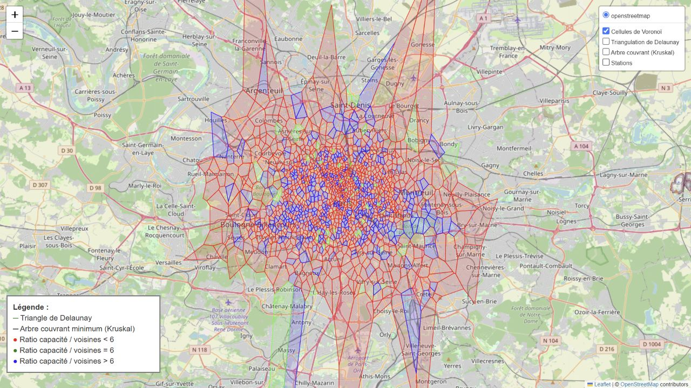

# Vélib’ - Cartographie des stations et de leurs voisines

Projet universitaire de cartographie de **1 473 stations Vélib’** à Paris et dans les communes voisines. À partir de leurs coordonnées et de leur capacité, deux cartes explorent la disposition des stations et leur voisinage.



## Explorer les cartes

- [Ouvrir la carte des stations et du réseau géométrique](https://arilesd.github.io/Projet-Velib/velib_stations_map.html) - Les triangles verts relient les stations voisines selon la triangulation de Delaunay. Les arêtes noires forment un arbre couvrant de poids minimal calculé avec l’algorithme de Kruskal.
- [Ouvrir la carte de Voronoï](https://arilesd.github.io/Projet-Velib/velib_stations_voronoi.html) - Chaque cellule affichée correspond à la zone géométriquement la plus proche de sa station. Les cellules ouvertes aux limites du réseau sont omises.

Le menu en haut à droite permet d’afficher les stations, la triangulation, l’arbre ou les cellules selon la carte. Une connexion Internet charge les composants de la carte et le fond cartographique. [Fond de carte © les contributeurs OpenStreetMap](https://www.openstreetmap.org/copyright)

Pour garder une copie sur ton ordinateur, télécharge les fichiers HTML depuis GitHub et ouvre-les dans ton navigateur. [Fichier des stations](velib_stations_map.html) · [Fichier de Voronoï](velib_stations_voronoi.html)

## Lire les couleurs

Le projet divise la capacité d’une station par le nombre de ses voisines dans la triangulation de Delaunay. La première carte colore ce ratio selon une échelle continue. La carte de Voronoï le classe autour d’un seuil de 6 choisi pour le projet.

Les calculs reposent sur les coordonnées et la capacité des stations. Les cellules décrivent la proximité géométrique. Une analyse de la desserte demanderait aussi des données d’usage et des temps de trajet.

## Données

Le dépôt contient un instantané de `station_information.json`. Le fichier porte l’horodatage du **20 janvier 2025 à 21 h 52, heure de Paris**. Il fournit l’identifiant, le nom, la latitude, la longitude et la capacité des stations. Le format correspond au flux public de localisation Vélib’ Métropole. [Données publiques Vélib’ - Smovengo / Syndicat Autolib’ Vélib’ Métropole](https://www.data.gouv.fr/datasets/velib-localisation-et-caracteristique-des-stations)

## Régénérer les cartes

Depuis la racine du dépôt, utilise Python 3.12 et installe les dépendances. Les deux fichiers JSON dérivés sont déjà fournis.

```bash
python -m pip install -r requirements.txt
python carte.py
python carte_voronoi
```

Pour reconstruire les JSON dérivés depuis l’instantané d’origine, lance d’abord `python code.py`, puis `python coordonnés.py`. Les cartes sont enregistrées sous les mêmes noms HTML que ceux des liens ci-dessus.
