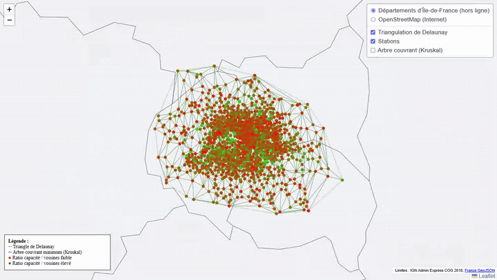

# Vélib’ - Cartographie des stations

Projet universitaire réalisé en équipe à partir d’un instantané de **1 473 stations Vélib’** à Paris et dans les communes voisines.

Les cartes montrent les stations, leurs voisines et les zones géométriquement les plus proches de chacune.

**Outils :** Python, Folium, NumPy et SciPy.

## Aperçu du projet

[Image en grand format](docs/apercu.png) · [Voir la vidéo](docs/presentation.mp4)

## Ouvrir les cartes

- [Carte des stations et de leurs voisines](https://arilesd.github.io/Projet-Velib/velib_stations_map.html).
- [Carte des cellules de Voronoï](https://arilesd.github.io/Projet-Velib/velib_stations_voronoi.html).

Le menu en haut à droite permet de choisir les éléments affichés :

- **Delaunay** relie les stations voisines par des triangles.
- **Kruskal** relie les stations par un arbre de longueur totale minimale.
- **Voronoï** dessine les zones les plus proches de chaque station.

Les couleurs représentent le rapport entre la capacité d’une station et son nombre de voisines.

## Télécharger et lancer

1. Installe [Python 3.14](https://www.python.org/downloads/) si besoin, en cochant **Add python.exe to PATH**.
2. [Télécharge le projet en ZIP](https://github.com/ArilesD/Projet-Velib/archive/refs/heads/main.zip), fais **Extraire tout**, puis ouvre le dossier extrait.
3. Double-clique sur **LANCER.cmd**.

Le premier lancement nécessite Internet pour installer les bibliothèques. Garde la fenêtre de lancement ouverte pendant l’utilisation et appuie sur **Entrée** dans cette fenêtre pour arrêter le projet.

Le lancement ouvre les cartes déjà calculées. Le fond OpenStreetMap nécessite Internet.

Données : [Vélib’](https://www.data.gouv.fr/datasets/velib-localisation-et-caracteristique-des-stations), instantané du 20 janvier 2025. Contours : [IGN Admin Express COG 2018 / France GeoJSON, Licence Ouverte](https://github.com/gregoiredavid/france-geojson#licence).

Fond de carte © [les contributeurs OpenStreetMap](https://www.openstreetmap.org/copyright).
